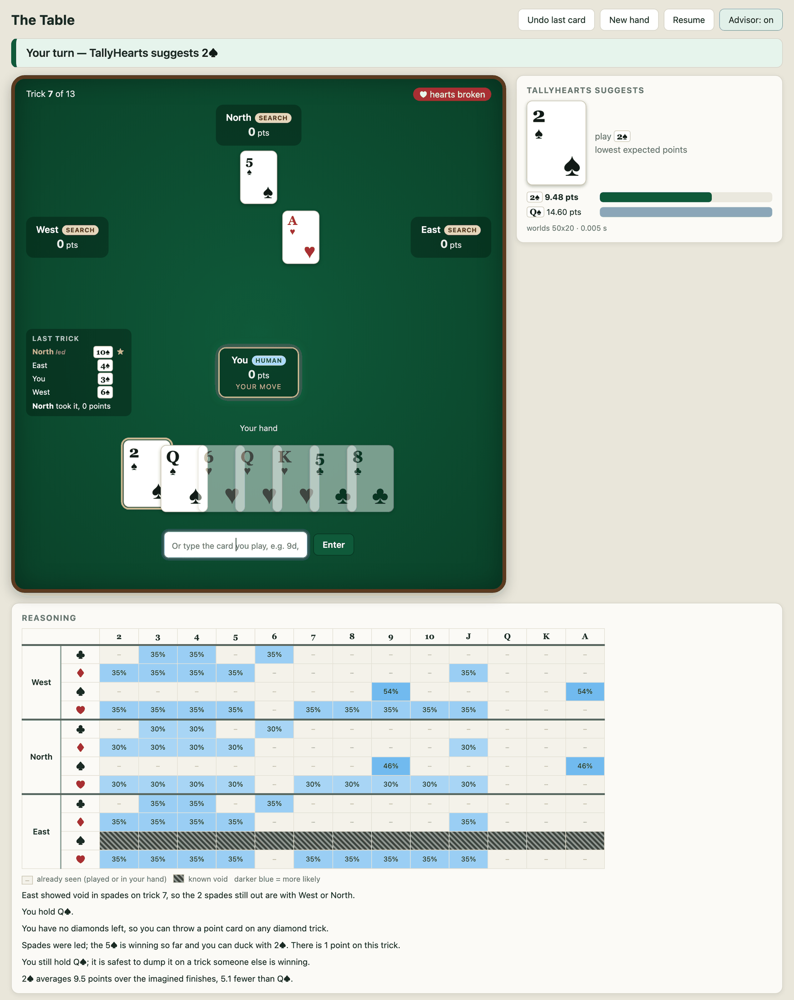
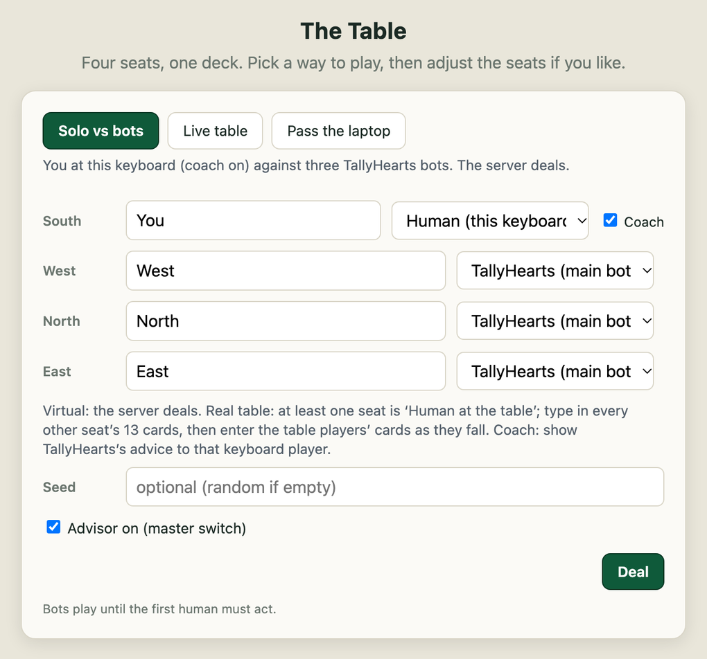
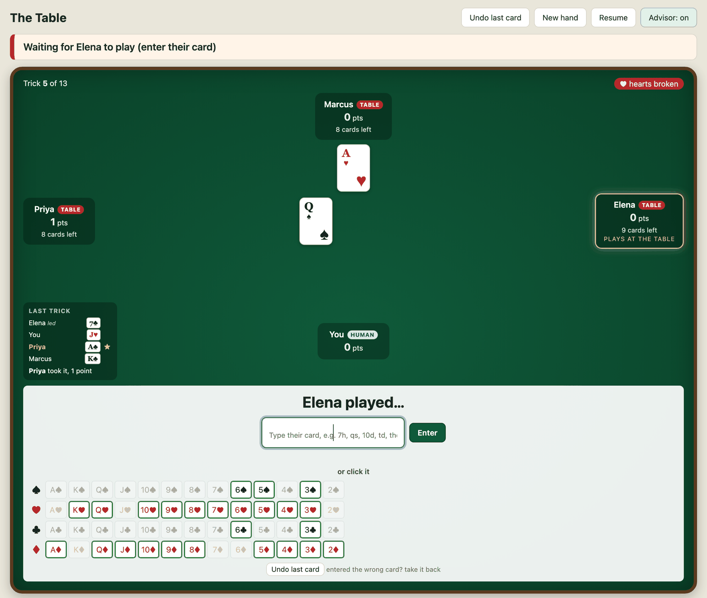
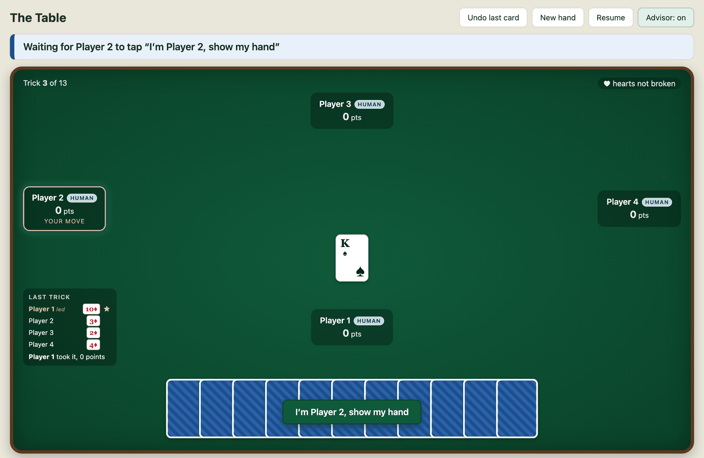

# open-hearts

**TallyHearts is a Hearts AI you can play against, or sit beside as a coach, in your browser.** It tracks exactly where every hidden card can be, imagines a thousand ways the hand could finish, and shows you its reasoning card by card.

This repository holds the bot, the browser table, and the full research record behind it: every benchmark, every chart, and the experiments that failed.



## Contents

- [Play it in two minutes](#play-it-in-two-minutes)
- [What you can do at the table](#what-you-can-do-at-the-table)
- [How TallyHearts thinks](#how-tallyhearts-thinks)
- [How strong is it?](#how-strong-is-it)
- [What is not claimed](#what-is-not-claimed)
- [Engineering](#engineering)
- [Repository map](#repository-map)
- [Further reading](#further-reading)

## Play it in two minutes

Requires Python 3.11 or newer.

```bash
git clone https://github.com/AmeyaKI/open-hearts.git
cd open-hearts
python -m venv .venv && source .venv/bin/activate
pip install -e '.[dev]'
python apps/table/server.py
```

Then open <http://127.0.0.1:8765/>. The server uses only the Python standard library and runs entirely on your machine.

## What you can do at the table



Every one of the four seats can be a person or a bot, in any mix. Three presets cover the common cases.

| Preset | What it is for |
|---|---|
| **Solo vs bots** | You play at the keyboard against three bots, with TallyHearts coaching you. |
| **Live table** | You are playing real cards with real people. Type in your own hand, enter each card as it falls, and get a suggestion on your turn. |
| **Pass the laptop** | Up to four people share one screen. Each hand stays hidden until its player taps to reveal it. Coaching is a per-seat setting. |

**The advisor.** On your turn TallyHearts suggests a card and shows its expected points for every legal play, so you can see how close the alternatives are.

**The reasoning panel.** A grid shows the probability that each opponent holds each unseen card. Known voids are hatched out. Plain-language sentences explain what drove the suggestion, for example that an opponent is out of spades, or that the queen of spades is safest dumped on a trick someone else is winning.

**Opponents you can seat.** TallyHearts itself, a beginner rulebook bot, a random player, 200 rule-based "expert" archetypes and randomly drawn personalities.

**Also built in.** Undo, autosave and resume, typed card entry, a complete record of every finished hand, and a log of each time you overruled the advisor.

| Live table: enter the cards other players put down | Pass the laptop: hands stay hidden between turns |
|---|---|
|  |  |

Prefer a terminal? `python experiments/relay.py --advise` gives the same advice in text form.

## How TallyHearts thinks

Hearts is a game of hidden information: you never see the other three hands. TallyHearts handles that in four steps.

1. **Keep an exact belief table.** For every unseen card, it holds the probability that each opponent has it. When a player cannot follow suit, they provably hold none of that suit, and because hand sizes are fixed that certainty shifts probability across the whole table. The update is computed exactly, not estimated.
2. **Sample possible worlds.** It deals out complete hidden hands that are consistent with everything seen so far.
3. **Play each world forward.** For every card it could play, it plays the rest of the hand out in each imagined world.
4. **Search honestly.** Inside each imagined future it re-samples the hidden cards as new information would appear, so it never plans as if it could see through the backs of the cards. A play that reveals information gets credit for revealing it.

It then plays the card with the lowest average points. The shipped configuration imagines 50 worlds with 20 re-samples each and decides in about 0.03 seconds.

## How strong is it?

A hand of Hearts hands out 26 penalty points among four players, so **6.5 points per hand is break-even and lower is better.** All results are on a simplified variant with no passing round and no shooting the moon, with both sides playing identical rules.

| Opponent | TallyHearts | Opponent | Result |
|---|---|---|---|
| **xinxin**, the long-standing reference Hearts program from the research literature, at its published configuration | **6.11** | 6.89 | Ahead by 0.78 points per hand (95% CI 0.64 to 0.91) over 14,000 games (1,000 deals in all 14 mixed seatings), while deciding about 9 times faster |
| **OpenSpiel ISMCTS**, a stock, untuned general-purpose search baseline at 1,000 simulations per move | **4.70** | 7.10 | Ahead by 2.4 points per hand over 1,000 matched deals. Giving the baseline 10 times more simulations did not close the gap |
| **OpenSpiel ISMCTS strengthened with Hearts knowledge**, built for this project from OpenSpiel's algorithm | | | Ahead by 1.10 points per hand (0.81 to 1.40) when the opponent had about 4 times the compute, and by 1.57 (1.29 to 1.86) at equal compute, over 500 matched deals |
| **Held-out rule-based experts**, never trained against | **4.76** | | Three experts split the remaining points |
| **A dedicated attacker** built to exploit TallyHearts specifically | | | Took an extra 0.20 points per hand (0.07 to 0.33): a small, measured leak |

Every comparison plays identical deals with seats rotated, and confidence intervals are bootstrapped over deals. The exact settings, sources, licenses, seeds and caveats for every opponent are in the [benchmark registry](docs/BENCHMARK_REGISTRY.md).

## What is not claimed

- **Not full Hearts yet.** There is no passing round and no shooting the moon. The xinxin result holds for this variant only. Full moon rules are planned.
- **No human-play results.** The table is built for it, but no formal data against people has been collected.
- **Opponent modelling did not pay.** Reading opponents' habits was worth roughly nothing against varied opponents, and a learned position evaluator lost to the exact simulator in every test. Both are written up alongside the wins.

## Engineering

- **Fast.** A 52-bit bitboard game representation and numba-compiled kernels give a measured 20 to 30 times end-to-end speedup, and a fused decision kernel adds a further 5.3 times.
- **Checked against a reference.** Every compiled kernel keeps its pure-Python reference implementation, and deterministic paths must produce bitwise-identical output before any speed figure is quoted. Run the reference paths with `OPENHEARTS_NO_JIT=1`.
- **No peeking by construction.** Player code only ever receives a filtered view of the game. A bot cannot read hidden hands even by accident.
- **Reproducible.** Experiments are seeded, checkpointed, and resumable. Expected outcomes were written down before each run and results are reported against them, misses included.

Run the tests:

```bash
python -m pytest -q                      # compiled paths
OPENHEARTS_NO_JIT=1 python -m pytest -q  # pure-Python reference paths
```

## Repository map

| Path | What lives there |
|---|---|
| [`apps/table/`](apps/table) | The browser table: local server, page, and the plain-language explanations |
| [`src/openhearts/engine/`](src/openhearts/engine) | Game engine and compiled kernels, with pure-Python references |
| [`src/openhearts/belief/`](src/openhearts/belief) | The exact belief table |
| [`src/openhearts/sampler/`](src/openhearts/sampler) | Sampling of hidden hands that respect every known constraint |
| [`src/openhearts/search/`](src/openhearts/search) | Honest search: the TallyHearts player |
| [`src/openhearts/players/`](src/openhearts/players) | Rule-based players, expert archetypes and personalities |
| [`src/openhearts/opponent/`](src/openhearts/opponent), [`value/`](src/openhearts/value) | The learned opponent profiler and position evaluator (both null results, kept for the record) |
| [`src/openhearts/eval/`](src/openhearts/eval) | Match harness, paired statistics and seeding |
| [`experiments/`](experiments) | Every benchmark and experiment, [indexed here](experiments/README.md) |
| [`tests/`](tests) | Test suite, run in both compiled and reference modes |
| [`docs/`](docs) | Research log, benchmark registry, charts and screenshots |

## Further reading

- **[Research log](docs/RESEARCH_LOG.md)**: the complete record, phase by phase, with every result table, chart, null result and known limitation.
- **[Benchmark registry](docs/BENCHMARK_REGISTRY.md)**: every opponent, exactly how it was configured, and the approved wording for each result.
- **[Experiments index](experiments/README.md)**: which script produced which result.
